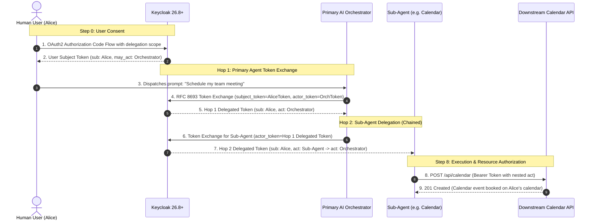

# AI Agent Token Exchange Delegation (RFC 8693)

Keycloak 26.8+ introduces preview support for **Token Exchange Delegation and Access Delegation for AI Agents and External Applications** (as discussed in [Skycloak's architecture guide](https://skycloak.io/blog/keycloak-26-8-token-exchange-delegation-ai-agents/)).

This feature solves the foundational identity problem for AI agents and Non-Human Identities (NHIs): allowing an autonomous agent to act on behalf of a human user with explicit consent, least-privilege scoping, and an immutable delegation chain recorded in the token's `act` claim.

---

## The Non-Human Identity (NHI) Problem in AI Agents

When building AI copilots, tools, or autonomous agents that invoke APIs on behalf of users, architects face two common anti-patterns:
1. **Over-privileged Bot Service Accounts:** The agent connects using a shared static credential. Downstream services cannot identify which human authorized the action, destroying auditability and non-repudiation.
2. **Raw Token Forwarding:** The human user hands their raw session access token to the agent. The agent inherits all the user's rights (no audience restriction, no scope narrowing), and if compromised, the entire user account is exposed.

### The Solution: RFC 8693 Token Exchange Delegation

OAuth 2.0 Token Exchange ([RFC 8693](https://datatracker.ietf.org/doc/html/rfc8693)) establishes a cryptographically verifiable delegation pattern:
- **`sub` (Subject):** The human resource owner whose data is being accessed (e.g. `shared.user`).
- **`act` (Actor):** A nested assertion identifying the agent executing the request (e.g. `client_id: "ai-agent"` and its service account ID).
- **`may_act` (Authorization assertion):** Embedded in the user's initial token upon consent, restricting *which* specific client has permission to exchange the token.

---

## Token Exchange Delegation vs. CIBA vs. Impersonation

| Capability | CIBA Support Delegation | Traditional Impersonation | Token Exchange Delegation (RFC 8693) |
|---|---|---|---|
| **Primary Use Case** | Human-in-the-loop support requests | Admin impersonating user for troubleshooting | AI agents & automated tools acting for users |
| **User Interaction** | Asynchronous out-of-band notification (push/polling) | None (Admin privilege) | Interactive OAuth2 consent screen |
| **Token `sub`** | Target user | Target user | Target user |
| **Token `act` claim** | **None** (only `azp`) | **None** (actor completely masks as user) | **Yes**: `{"client_id": "ai-agent", "sub": "..."}` |
| **Token Scopes** | Inherits client scopes | Inherits user roles | **Narrowed** (delegation scope stripped) |
| **Privilege Escalation Risk** | Low (scoped to user) | High (admin token conversion) | **Zero** (no Admin API escalation allowed) |

---

## Architectural Workflow

```
[ Human User ]                          [ AI Agent Client ]               [ Keycloak 26.8+ ]
     |                                           |                                |
     | 1. Login + scope=delegation:client:ai-agent|                                |
     |--------------------------------------------------------------------------->|
     |                                           |                                |
     | 2. Keycloak prompts consent screen        |                                |
     |    "Grant access to ai-agent?"            |                                |
     |    (Checks FGAP V2 'delegate' permission) |                                |
     |                                           |                                |
     | 3. Returns User Subject Token             |                                |
     |    (has 'may_act' + aud=['ai-agent'])     |                                |
     |<---------------------------------------------------------------------------|
     |                                           |                                |
     | 4. Hands subject token to AI agent        |                                |
     |------------------------------------------>|                                |
     |                                           | 5. Client Credentials          |
     |                                           |    (Obtains Agent Actor Token) |
     |                                           |------------------------------->|
     |                                           |<-------------------------------|
     |                                           |                                |
     |                                           | 6. Token Exchange (RFC 8693)   |
     |                                           |    subject_token + actor_token |
     |                                           |------------------------------->|
     |                                           |                                |
     |                                           | 7. Mint Delegated Token        |
     |                                           |    sub: user                   |
     |                                           |    act: ai-agent               |
     |                                           |<-------------------------------|
     |                                           |                                |
     |                                           | 8. Call Downstream API         |
     |                                           |    Authorization: Bearer <tok> |
     |                                           |------------------------------->|
```

---

## Token Comparison

### 1. User's Subject Token (Pre-Exchange)

Contains the explicit authorization grant in `may_act` and lists `ai-agent` in `aud`:

```json
{
  "iss": "http://localhost:8082/realms/platform",
  "aud": ["ai-agent", "account"],
  "sub": "89546b1a-2354-4c75-9eef-b6ceefcd4b4a",
  "azp": "delegation-demo-app",
  "scope": "openid delegation:client:ai-agent profile email",
  "preferred_username": "shared.user",
  "may_act": {
    "client_id": "ai-agent",
    "sub": "25022fde-2400-43d6-b5f4-690b7ad830e0"
  }
}
```

### 2. Delegated Access Token (Post-Exchange)

Keycloak verifies `may_act`, checks Fine-Grained Admin Permissions, strips the parameterized scope, and attaches the immutable `act` claim:

```json
{
  "iss": "http://localhost:8082/realms/platform",
  "aud": "account",
  "sub": "89546b1a-2354-4c75-9eef-b6ceefcd4b4a",
  "azp": "ai-agent",
  "scope": "profile email",
  "preferred_username": "shared.user",
  "act": {
    "client_id": "ai-agent",
    "sub": "25022fde-2400-43d6-b5f4-690b7ad830e0"
  }
}
```

---

## How Delegation Scopes Work (Addition, Resolution & Attenuation)

A common question in AI agent architectures is: **how does the delegation scope actually get created, validated, requested, and mapped into the token?**

In Keycloak 26.8+, this involves a four-phase lifecycle:

```
[ 1. Realm Engine ]                  [ 2. FGAP V2 Gatekeeper ]             [ 3. OAuth2 Request ]          [ 4. RFC 8693 Exchange ]
KC_FEATURES enabled                   Checks admin-permissions              App requests dynamic scope      Agent exchanges token
        │                                        │                                    │                                  │
Registers parameterized                  Verifies target client                GET /auth?scope=                   Strips delegation:client
scope `delegation:client`                has `delegate` permission             delegation:client:ai-agent         Narrows functional scopes
with 3 protocol mappers                  on resource type `Users`              User consents on screen            Attaches `act` claim
```

### 1. Realm Engine: Parameterized Scope Registration
Unlike traditional static scopes (like `openid` or `profile`), delegation requires dynamic arguments specifying **which** client is receiving delegation authority.

When Keycloak boots with `KC_FEATURES="parameterized-scopes,token-exchange-delegation"`, it automatically provisions:
- **Scope Name**: `delegation:client`
- **Scope Type**: `client-delegation` (`is.parameterized.scope: true`)
- **Three Automatic Protocol Mappers**:
  1. `client may_act client_id` (`oidc-parameterized-scope-mapper`):
     - Parses `:ai-agent` from the scope string and writes it to `may_act.client_id`.
  2. `client may_act sub` (`oidc-parameterized-scope-client-sub-mapper`):
     - Resolves the service account UUID of `ai-agent` and maps it to `may_act.sub`.
  3. `client delegation audience` (`oidc-parameterized-scope-audience-mapper`):
     - Appends the target client ID (`ai-agent`) to the token's `aud` array so downstream verification passes.

### 2. The Authorization Gate: Fine-Grained Admin Permissions (FGAP V2)
Keycloak will **never** allow an untrusted client to receive delegation by default. Before presenting the scope on the consent screen or minting it into a token, Keycloak consults the realm's `admin-permissions` authorization engine:

- **Resource Server**: `admin-permissions`
- **Resource Type**: `Users`
- **Scope**: `delegate`
- **Policy**: `ai-agent-sa-policy` (bound to `service-account-ai-agent`)

> [!IMPORTANT]
> If a malicious or unauthorized client requests `scope=delegation:client:rogue-agent`, Keycloak checks FGAP V2. Because `rogue-agent` lacks the `delegate` permission on `Users`, Keycloak **silently drops the scope** from the request. The user is never prompted, and no `may_act` assertion is minted.

### 3. Application Request & User Consent
The frontend or client application initiates the standard OAuth 2.0 authorization code flow:

```http
GET /realms/platform/protocol/openid-connect/auth?
    client_id=delegation-demo-app
    &response_type=code
    &redirect_uri=http://localhost:3000/ai-agent/callback
    &scope=openid profile email delegation:client:ai-agent
```

1. **Evaluation**: Keycloak validates client scopes and verifies FGAP V2 permissions.
2. **Interactive Consent**: Because `display.on.consent.screen: true` is configured, Keycloak prompts the user:
   > *"Grant permission for **ai-agent** to act on your behalf?"*
3. **Subject Token Minting**: Keycloak issues the user's Subject Token with `may_act`:
   ```json
   {
     "sub": "alice-uuid",
     "aud": ["account", "ai-agent"],
     "scope": "openid profile email delegation:client:ai-agent",
     "may_act": {
       "client_id": "ai-agent",
       "sub": "agent-service-account-uuid"
     }
   }
   ```

### 4. Scope Attenuation (Narrowing) During Token Exchange
When `ai-agent` performs the RFC 8693 token exchange, it calls the token endpoint with:
- `subject_token`: The user's subject token.
- `actor_token`: The agent's own service account token.
- `scope` (optional): The narrowed list of functional scopes it actually needs (e.g. `scope=calendar:read`).

Keycloak applies **Monotonic Scope Attenuation**:
1. It verifies that the requested scopes are a subset of the consented scopes.
2. It **strips** `delegation:client:ai-agent` from the resulting access token (preventing the delegated token from being arbitrarily re-exchanged).
3. It emits the final delegated token with the requested functional scopes and the immutable `act` claim.

---

## Agent Client ID & Non-Human Identity (NHI) Architecture

### Does the AI Agent Have Its Own Client ID?
**Yes.** In Keycloak, every autonomous agent is modeled as a distinct **Confidential Client** (in our PoC, `client_id: "ai-agent"`).

### Why the Agent Must Have Its Own Client ID

1. **Target of User Authorization**:
   The user does not grant blanket delegation to the world; they consent to a specific agent identity:
   `scope=delegation:client:ai-agent`
   Keycloak stamps `may_act.client_id = "ai-agent"` directly into the user's token.

2. **Cryptographic Binding & Theft Prevention**:
   When exchanging the token, Keycloak requires the agent to authenticate via its own client credentials:
   $$\text{Caller Client ID} == \text{subject\_token}.\texttt{may\_act.client\_id}$$
   Even if an attacker intercepts the user's subject token, they **cannot exchange it** without possessing the private client secret (or mTLS key / private_key_jwt) of `ai-agent`.

3. **Separation of Caller (`azp`) and Subject (`sub`)**:
   - `sub`: Identifies the human resource owner (e.g. Alice).
   - `azp`: Identifies the calling application/agent (`ai-agent`).
   - `act`: Certifies the non-human service account executing the request on Alice's behalf.

4. **Multi-Agent Governance & Least Privilege**:
   Different agents in your organization (e.g., `ai-orchestrator`, `calendar-sub-agent`, `sql-runner`) each maintain their own client ID, secret, and FGAP V2 policies. This ensures that compromising a single specialized sub-agent does not expose tokens or permissions of any other agent.

---

## Keycloak 26.8 Configuration

### 1. Feature Flags (`docker-compose.yml`)

Keycloak must be started with:
```yaml
KC_FEATURES: "token-exchange-delegation,parameterized-scopes,admin-fine-grained-authz:v2"
```

### 2. Parameterized Scopes & Automatic Scopes

When enabled, Keycloak automatically provisions:
- `delegation:client`: OpenID Connect parameterized scope type `client-delegation`.
- Automatically added to realm `default-optional-client-scopes`.
- Appends target client ID to `aud` and sets `may_act.client_id` + `may_act.sub`.

### 3. Fine-Grained Admin Permissions (FGAP V2)

Keycloak enforces that the actor client cannot arbitrarily receive delegations unless permitted by FGAP V2:
1. `adminPermissionsEnabled: True` on the realm.
2. Resource server `admin-permissions` receives:
   - User policy `ai-agent-sa-policy` targeting `service-account-ai-agent`.
   - Scope permission `ai-agent-delegate-users-permission`:
     - `resourceType`: `"Users"`
     - `scopes`: `["delegate"]`
     - `policies`: `["ai-agent-sa-policy"]`

Without this permission, Keycloak silently drops `delegation:client:<client_id>` during login, ensuring unauthorized workloads cannot harvest delegation assertions.

### 4. Client Attributes

`ai-agent` confidential client must have:
- `serviceAccountsEnabled: True`
- `attributes`: `{"standard.token.exchange.enabled": "true"}`

---

## Running the Demo

### 1. Interactive Web UI (Browser Flow)
Open the dedicated UI in your browser:
```
http://localhost:3000/ai-agent
```
1. Click **Launch Interactive Delegation Flow**.
2. Log in as `shared.user` (password `password123`) or any federated tenant user.
3. Review and click **Accept** on Keycloak's consent prompt for `ai-agent`.
4. The UI captures the callback, executes the token exchange, and renders all 4 steps:
   - User Subject Token (with `may_act` assertion).
   - AI Agent Actor Token (service account non-human identity).
   - Exchanged Delegated Token (with `act` delegation chain claim).
   - Downstream API query proving authorized access.

### 2. Automated CLI Run
Execute the end-to-end Python script:
```bash
python3 scripts/demo_ai_agent_delegation.py
```

### 3. Smoke Test Suite
The workflow is part of the automated smoke tests:
```bash
python3 scripts/verify.py
```
*(Test 5 verifies consent, `may_act` issuance, token exchange, the `act` claim, and downstream API queries).*

---

## Sub-Agents & Multi-Hop Delegation (Hierarchical AI Systems)

In enterprise AI systems (such as multi-agent frameworks, LangGraph, AutoGen, or CrewAI), a single agent rarely performs all tasks directly. Instead, a **Primary AI Orchestrator** decomposes complex goals into specialized sub-tasks and delegates them to **Sub-Agents** (e.g. Calendar Agent, SQL Runner, GitHub Agent, Payment Agent).

### The Sub-Agent Problem
When a sub-agent performs actions on behalf of the user, traditional authentication breaks down:
- **Bot Token Anti-Pattern:** The sub-agent uses a static bot token. The downstream database or API sees only the sub-agent, losing all record of which human user initiated the request and which orchestrator dispatched the sub-agent.
- **Pass-the-Token Anti-Pattern:** The orchestrator forwards the user's broad access token to the sub-agent. If the sub-agent is compromised, the attacker inherits full access to the user's entire account across all services.

### The RFC 8693 Solution: Nested `act` Claims
[RFC 8693 Section 4.1](https://datatracker.ietf.org/doc/html/rfc8693#section-4.1) standardizes multi-hop delegation chains using **nested `act` (Actor) claims**:

> *"A chain of delegation can be expressed by nesting one `act` claim within another. The outermost `act` claim represents the current actor while nested `act` claims represent prior actors. The least recent actor is the most deeply nested. The nested `act` claims serve as a history trail that connects the initial request and subject through the various delegation steps undertaken before reaching the current actor."*

### Keycloak 26.8 Internal Implementation

Keycloak 26.8+ natively implements nested delegation in `TokenExchangeDelegationProvider.java`:

```java
// org.keycloak.protocol.oidc.tokenexchange.TokenExchangeDelegationProvider
protected void checkRequestedAudiences(TokenManager.AccessTokenResponseBuilder builder) {
    super.checkRequestedAudiences(builder);
    
    // 1. Extract the may_act claim from the subject_token
    Map mayAct = new HashMap((Map) subjectAccessToken.getOtherClaims().get("may_act"));
    
    // 2. Check if the incoming actor_token already has an 'act' claim (from a previous delegation hop)
    Object prevAct = actorAccessToken.getOtherClaims().get("act");
    
    // 3. If a previous actor exists, nest it inside the new act claim
    if (prevAct != null) {
        mayAct.put("act", prevAct);
    }
    
    // 4. Attach the nested delegation chain to the newly minted access token
    builder.getAccessToken().getOtherClaims().put("act", mayAct);
}
```

### Multi-Hop Delegation Workflow



### Token Claim Evolution Across Hops

#### Hop 1: Primary Orchestrator Token
Issued after the first token exchange:
```json
{
  "iss": "http://localhost:8082/realms/platform",
  "aud": "account",
  "sub": "89546b1a-2354-4c75-9eef-b6ceefcd4b4a",
  "azp": "ai-orchestrator",
  "scope": "openid profile email calendar",
  "act": {
    "client_id": "ai-orchestrator",
    "sub": "25022fde-2400-43d6-b5f4-690b7ad830e0"
  }
}
```

#### Hop 2: Sub-Agent Delegated Token (Nested `act`)
Issued after the second token exchange:
```json
{
  "iss": "http://localhost:8082/realms/platform",
  "aud": "calendar-service",
  "sub": "89546b1a-2354-4c75-9eef-b6ceefcd4b4a",
  "azp": "sub-agent-calendar",
  "scope": "calendar:write",
  "act": {
    "client_id": "sub-agent-calendar",
    "sub": "9c1234ef-5678-43d6-a123-7890abcdef12",
    "act": {
      "client_id": "ai-orchestrator",
      "sub": "25022fde-2400-43d6-b5f4-690b7ad830e0"
    }
  }
}
```

### Resource Server Evaluation Rules

When downstream APIs or microservices receive a nested token, RFC 8693 establishes two clear guidelines:

1. **Authorization Decisions (Access Control):**
   - The Resource Server authorizes access based **only** on:
     - The **Resource Owner** (`sub`: Alice) — does Alice have permission to modify this calendar?
     - The **Immediate Actor** (outermost `act.client_id`: `sub-agent-calendar`) — is this specific sub-agent allowed to invoke calendar write APIs?
2. **Audit Trails & Provenance (Non-Repudiation):**
   - The **Nested Actors** (`act.act`: `ai-orchestrator`) are **strictly informational** for security monitoring and audit logging.
   - Downstream services log the complete provenance chain to SIEM / OpenSearch:
     `User(Alice) -> Delegator(ai-orchestrator) -> Executor(sub-agent-calendar)`.

### Scope Attenuation & Least Privilege Guardrails

Keycloak 26.8+ enforces strict guardrails across multi-hop agent chains:
- **Monotonic Scope Attenuation:** A sub-agent can **never** receive more permissions or broader scopes than the delegating orchestrator held. Scopes can only stay equal or be narrowed down (e.g. `calendar` narrowed down to `calendar:write`).
- **Audience Restrictions:** The token exchanged for the sub-agent should restrict `aud` to only the specific downstream API (`calendar-service`), preventing the sub-agent from re-using the token against unrelated user services.
- **FGAP V2 Policy Enforcement:** Each agent in the chain (both orchestrator and sub-agents) must be granted explicit `delegate` permission on `Users` within Keycloak's Fine-Grained Admin Permissions (FGAP V2). Any attempt by an unapproved bot client to participate in the delegation chain is rejected with `invalid_scope` or `403 Forbidden`.
