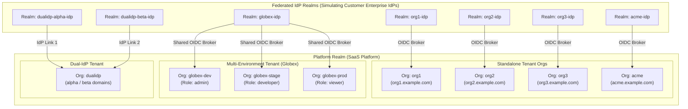
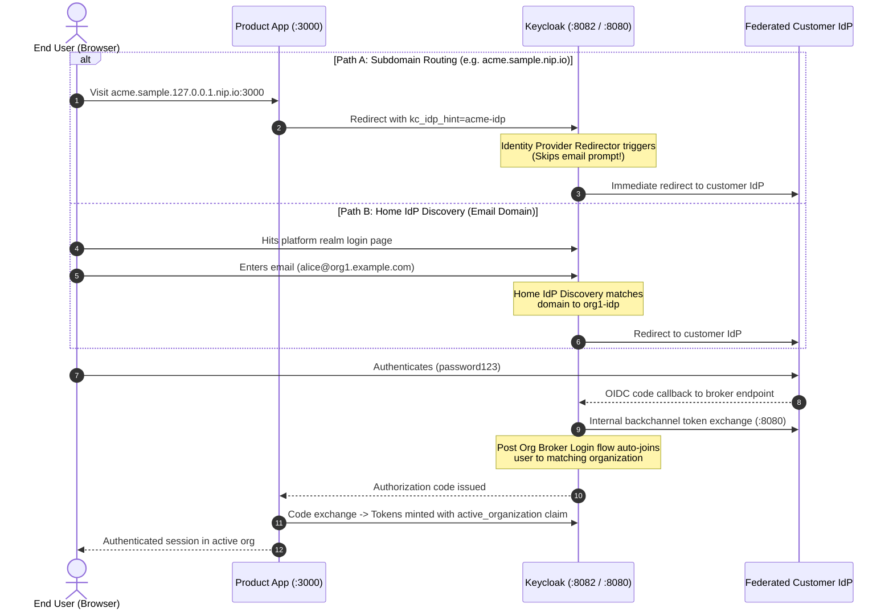
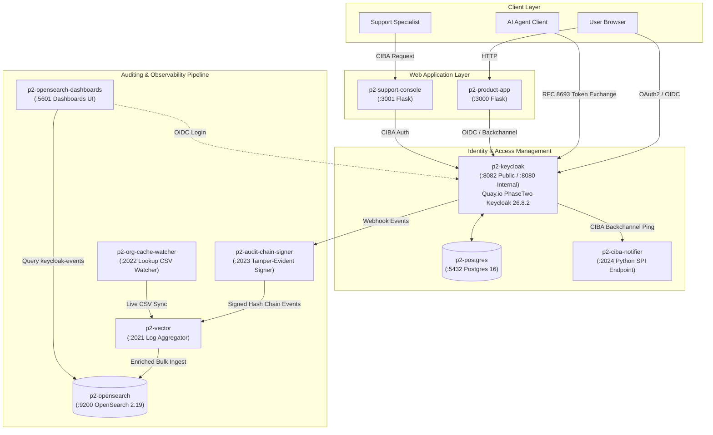

# Architecture

One Keycloak instance (`quay.io/phasetwo/phasetwo-keycloak:26.8.2`), running the `platform` SaaS realm alongside federated IdP realms:

- **`platform`** — the SaaS realm. Hosts 8 organizations:
  - `org1`, `org2`, `org3`, `acme` — each its own standalone tenant, 1 org = 1 tenant = 1 IdP (see `keycloak_admin.TENANTS`).
  - `globex-dev`, `globex-stage`, `globex-prod` — **one tenant, three environments**, sharing a single IdP (see [multi-env-tenants.md](multi-env-tenants.md)).
  - `dualidp` — test scenario for a single org linked to two federated IdPs (`dualidp-alpha` and `dualidp-beta`) with domain narrowing (see [dual-idp-precedence.md](dual-idp-precedence.md)).
- **Federated IdP Realms (`org1-idp`, `org2-idp`, `org3-idp`, `acme-idp`, `globex-idp`, etc.)** — one federated realm per tenant, standing in for that tenant's own external IdP (e.g. their Okta/Azure AD/Workforce IdP). Each has a confidential broker client and test users (`alice@<tenant-domain>` / `password123`).

---

## Realm & Organization Topology

---

## Login Flow & Identity Brokering

Two routing mechanisms route users into the broker infrastructure:

- **Email-domain based** (`org1`/`org2`/`org3`): A user hits `platform`'s login page, enters their email, and PhaseTwo's **Home IdP Discovery** authenticator matches the email domain to the org's registered domain (`orgN.example.com`), silently redirecting to that org's federated IdP realm.
- **Subdomain based** (`acme`, see [tenant-routing.md](tenant-routing.md)): A tenant-scoped product app already knows which org a visitor belongs to from the URL itself, and sends `kc_idp_hint=<alias>` on the authorization request. Keycloak's built-in **Identity Provider Redirector** redirects straight to that IdP, skipping Home IdP Discovery's email prompt entirely.

Either way, after authenticating at the org's IdP, the user is brokered back into `platform`, and PhaseTwo's built-in **post org broker login** flow automatically associates them as a member of the matching organization.

---

## Active Organization

A user can belong to multiple orgs (see `shared.user`, a member of both `org1` and `org2`, or `alice@globex.example.com`, a member of all three `globex-*` envs). 

- Their "active" org is tracked in a read-only user attribute (this attribute **persists across logins** — see the gotcha in [multi-env-tenants.md](multi-env-tenants.md)).
- Exposed in tokens via a custom `active_organization` claim (from the `active-organization` client scope, including `id`, `name`, `role`, and `attribute` — the last two are how [multi-env-tenants.md](multi-env-tenants.md) surfaces per-env roles and the `tenant` grouping attribute for free).
- Can be dynamically switched via a dedicated switch endpoint (`PUT /realms/platform/users/switch-organization`).

---

## Why Two URLs (`KC_URL` vs `KC_INTERNAL_URL`)

Keycloak brokers `org1`/`org2`/`org3` as OIDC IdPs of the *same* server instance.
The browser needs the host-mapped address (`http://localhost:8082`), but Keycloak's own server-to-server broker calls (token exchange, JWKS, userinfo) happen *from inside the container*, where `localhost:8082` isn't listened on (only its internal port 8080 is). So each org's IdP config uses:
- `authorizationUrl` / `logoutUrl` → `http://localhost:8082/...` (browser-visible)
- `tokenUrl` / `jwksUrl` / `userInfoUrl` → `http://localhost:8080/...` (container-internal)

Separately, `KC_HOSTNAME` is pinned to a **fully-qualified** `http://localhost:8082` with `KC_HOSTNAME_BACKCHANNEL_DYNAMIC=true`. Without this, a bare `KC_HOSTNAME=localhost` makes the `iss` (issuer) claim in every token vary based on which host/port a request came in on — which breaks issuer validation the moment the broker calls the internal port. Pinning the hostname keeps `iss` constant everywhere.

---

## Full Container Topology & Event Pipeline

| Container | Image | Purpose |
|---|---|---|
| `p2-postgres` | `postgres:16-alpine` | Keycloak's relational database |
| `p2-keycloak` | `quay.io/phasetwo/phasetwo-keycloak:26.8.2` | Identity platform (SaaS platform realm + federated tenant IdP realms) |
| `p2-opensearch` | `opensearchproject/opensearch:2.19.1` | Event store, index `keycloak-events`; security enabled, Keycloak-backed OIDC login — see [opensearch-auth.md](opensearch-auth.md) |
| `p2-opensearch-dashboards` | `opensearchproject/opensearch-dashboards:2.19.1` | UI for browsing/visualizing events; log in via Keycloak |
| `p2-vector` | `timberio/vector:latest-alpine` | OpenSearch ingest (from `audit-chain-signer`, not Keycloak directly), with org-name enrichment |
| `p2-audit-chain-signer` | `python:3.12-alpine` running `scripts/audit_chain_signer.py` | Receives Keycloak's webhook, attaches a tamper-evident SHA-256 hash chain link, forwards to Vector — see [audit-log-integrity.md](audit-log-integrity.md) |
| `p2-org-cache-watcher` | `python:3.12-alpine` running `scripts/org_cache_watcher.py` | Keeps Vector's org id→name lookup table live in sync with Keycloak |
| `p2-product-app` | built from `app/Dockerfile` (Flask + Authlib) | Demo multi-tenant product app for subdomain-based IdP routing, multi-env switching, and AI delegation — see [tenant-routing.md](tenant-routing.md) and [multi-env-tenants.md](multi-env-tenants.md) |
| `p2-support-console` | built from `support_console_app/Dockerfile` | Web UI for initiating user-approved delegated access via OIDC CIBA — see [ciba-support-delegation.md](ciba-support-delegation.md) |
| `p2-ciba-notifier` | `python:3.12-alpine` running `scripts/ciba_notifier.py` | Receives Keycloak CIBA authentication channel notifications — see [ciba-support-delegation.md](ciba-support-delegation.md) |

See [event-logging.md](event-logging.md) for how the OpenSearch-related pipeline components fit together, [tenant-routing.md](tenant-routing.md) for the single-org-per-tenant demo, [multi-env-tenants.md](multi-env-tenants.md) for the multi-env-per-tenant demo, [ciba-support-delegation.md](ciba-support-delegation.md) for CIBA, and [ai-agent-delegation.md](ai-agent-delegation.md) for AI Agent Token Exchange Delegation.
